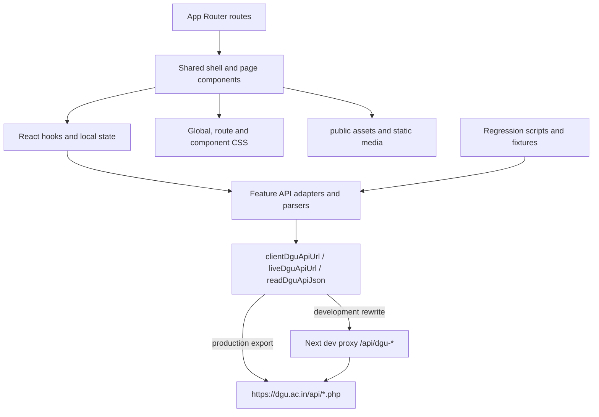

# DGU Project Architecture

Source-verified reference for the DGU/DBS Global University website. This document describes the current checkout; it does not prescribe a redesign or change runtime behavior.

## Executive summary

The project is a Next.js 16 App Router application using React 19, TypeScript, static production export, client-side API feeds, and a shared DGU visual system. The production build emits a static site, while content is fetched by browser-side adapters from the live DGU PHP APIs. During development, the browser calls same-origin `/api/dgu-*` paths and `next.config.ts` rewrites those paths to the live APIs.

Important sources:

- Runtime configuration: `next.config.ts:1-36`, `tsconfig.json`, `package.json`.
- Root composition: `app/layout.tsx`, `app/page.tsx`.
- Shared transport and response validation: `components/dgu-api-transport.ts`, `components/dgu-content-api.ts`.
- Academic route identity and API page: `components/academic-route-identities.ts`, `components/AcademicQueryPage.tsx`, `components/AcademicApiPage.tsx`, `components/academic-page-api.ts`.
- Shared chrome: `components/Navigation.tsx`, `components/SiteFooter.tsx`, `components/LocalPageShell.tsx`.
- Global visual system: `app/global.css`, `app/page-consistency.css`, `app/academic-reference.css`, `components/academic-api.css`, route-specific CSS files, and `public/assets/`.

## Runtime layers

### Route layer

`app/` contains static routes, dynamic content routes, dynamic school/program routes, and compatibility routes. Dynamic pages generally resolve a slug/ID in the route component, then delegate to a client renderer inside `Suspense`.

### Presentation layer

The homepage (`app/page.tsx`) owns the full homepage composition. Academic pages share `AcademicApiPage` and use `AcademicContent`, tab/accordion components, `SchoolPlacementsSection`, faculty, recruiters, news, forms, and media blocks. Local/CMS pages use `LocalPageShell`, `LocalContentPage`, or specialized page components.

### Data layer

Adapters normalize multiple PHP response shapes using case-insensitive field lookup and safe media/text helpers. Most authenticated feeds use the shared menu API key as a fallback when a feed-specific key is absent. Credentials are read from environment variables and must never be logged or documented by value.

### Styling and assets

The design is primarily CSS-driven. `app/global.css` contains shared typography, spacing, sliders, placement and responsive rules. Route CSS adds school, program, admissions, news, faculty, campus, and page-specific behavior. The project uses the existing Clash Grotesk/font and static assets under `public/`; source references use the `/` base path.

## Configuration and deployment model

`next.config.ts` preserves:

- `basePath: ''`.
- `trailingSlash: true`.
- `images.unoptimized: true`.
- `output: 'export'` outside development.
- Development-only API rewrites and compatibility rewrites.

`package.json` scripts:

- `npm run dev`: Next development server.
- `npm run lint`: ESLint.
- `npx tsc --noEmit`: TypeScript check.
- `npm run build`: static export; `prebuild` removes `out`, and `postbuild` edits the generated export rules. Run only with explicit awareness of that side effect.
- `npm start`: serves the export through `scripts/serve-export.cjs`.
- Regression scripts: `test:audit`, `test:recovery`, `test:academic`, `test:live-api`, `test:admissions`, and `test:placements`.

## PHP folders

`backend-api/` contains `get-program-info.php`. `server-api/api/` contains local/restored PHP endpoint copies and the shared `dgu-academic-common.php`. Frontend code does not import PHP files; runtime API calls use URLs assembled by the TypeScript transport. Treat the PHP folders as deployment/testing dependencies until a separate reference audit proves otherwise.

## Current working-tree context

At documentation time, the working tree contains existing user changes in `AGENTS.md`, placement/admissions-related components, and a status-only PHP entry for `backend-api/get-program-info.php`. The PHP worktree hash matches `HEAD`, so it has no content diff. These changes are preserved and are not part of this documentation task.

